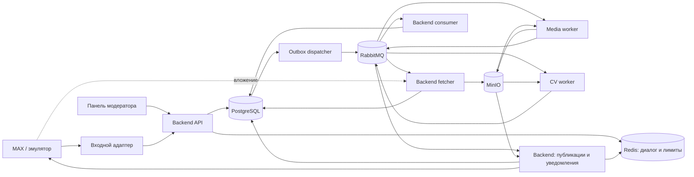

# MAX Photo Feed — архитектура

Версия 1.3 · 21 октября 2026 · команда из четырёх разработчиков.

Тематическая фотолента в MAX: пользователь отправляет фотографию и подтверждает согласие, система проверяет файл и содержание, публикует одобренное изображение в канале и уведомляет автора. Модератор пересматривает решения; организатор получает рейтинг и проводит розыгрыш.

Этот документ — обзор и точка входа: объём, архитектура, стек и сквозной сценарий. Подробности — в документах ниже. Постановка — [assignment.md](assignment.md); обязательные функции и метрики сверены с ней. Решения, требующие отдельного обоснования, фиксируем в `docs/adr/` (папка появится вместе с первым ADR).

| Документ | О чём | Ведёт |
| --- | --- | --- |
| [assignment.md](assignment.md) | Постановка: что требуется | — |
| [mvp.md](mvp.md) | Состав MVP, схемы компонентов и сквозного сценария, критерии готовности | Команда |
| [sprints.md](sprints.md) | План спринтов: демо и задачи | Команда |
| [team.md](team.md) | Роли и границы ответственности | Команда |
| [contracts.md](contracts.md) | События и очереди, outbox/inbox/ACK, повторы и DLQ, интеграция с MAX | Dev2 |
| [data-model.md](data-model.md) | Таблицы, статусы заявки, жизненный цикл публикации, дубли, рейтинг и розыгрыш | Dev2 |
| [moderation.md](moderation.md) | Выбор CV, политика модерации, оценка качества | Dev3 |
| [security.md](security.md) | Файловый конвейер, меры защиты, персональные данные | Dev4 |
| [testing.md](testing.md) | Виды тестов, правила допуска, метрики постановки | Dev4 |
| [operations.md](operations.md) | Окружения, запуск, логи и метрики | Dev1 |
| [results/max-check.md](results/max-check.md) | Протокол проверки реального MAX (S1-04) | Dev1 |
| [risks.md](risks.md) | Риски и открытые решения | Команда |

## 1. Объём проекта

| Входит в сдаваемую версию | После работающего сквозного сценария | За пределами текущего объёма |
| --- | --- | --- |
| Бот, согласия, обработка фото, CV, ручная модерация, публикация и отзыв поста | Реальные реакции или согласованное голосование кнопками, рейтинг и розыгрыш — завершить до сдачи | Отдельные staging и production, автоматический CD |
| PostgreSQL, RabbitMQ, MinIO, Redis для временного диалога и лимитов | Prometheus и Grafana, измерение задержек и ресурсов | Kubernetes, кластер БД/брокера, обязательные API-реплики |
| Outbox, inbox, идемпотентность, ограниченные повторы, DLQ, аудит, rate limiting, CI | Дополнительные браузерные и нагрузочные тесты; Playwright/k6 при необходимости | OpenTelemetry, Loki, сложная сетевая топология |
| Карантин, очистка изображений, проверка прав, изоляция media и CV | Проверка восстановления из резервной копии на демо-стенде | Обучение собственной модели и отдельная продуктовая платформа |

Окружения: локальное у каждого разработчика и один общий демо-стенд. Для разработки и учебной демонстрации используем эмулятор или polling. Если проект переходит к эксплуатации реального сервиса, включаем webhook и HTTPS по требованиям MAX.

Постановка допускает публикацию в эмулятор канала и «полностью воспроизводимый эмулятор» вместо реального бота и ленты. Реальный тестовый канал — цель спринта 5, но не условие сдачи. Открытым остаётся только источник рейтинга ([data-model.md](data-model.md) §5).

## 2. Архитектура и стек

Модульный Backend владеет бизнес-состоянием и PostgreSQL. Сетевой доступ к MAX есть только у процессов Backend. Media и CV работают без интернета, выполняют задания и возвращают результаты через RabbitMQ. Скачивание вложений, публикация и уведомления — фоновые процессы Backend, использующие общую доменную логику.



Стрелки на этой схеме, как и на схемах MVP в [mvp.md](mvp.md), показывают поток данных.

| Область | Выбор | Назначение |
| --- | --- | --- |
| Backend | Python, FastAPI, Pydantic, Uvicorn | API, валидация, OpenAPI |
| Данные | PostgreSQL, SQLAlchemy 2, Alembic | Заявки, согласия, решения, аудит и миграции |
| Временный диалог и лимиты | Redis | FSM с TTL и счётчики rate limiting. Потеря данных Redis сбрасывает диалог и окна лимитов, но не бизнес-состояние |
| Очереди | RabbitMQ + aio-pika | Собственный JSON-контракт, явные ACK и publisher confirms |
| Медиа | Pillow; OpenCV только при необходимости | Декодирование, очистка, измерение качества |
| CV | Готовая модель тематики и отдельная проверка NSFW | Конкретные веса выбираются по результатам эксперимента |
| Хранилище | Приватное S3-compatible; локально и на демо MinIO | Оригиналы и очищенные изображения |
| Интерфейс | React + TypeScript | Модерация, история, рейтинг и розыгрыш |
| Запуск и проверки | Docker Compose, GitHub Actions, pytest, Ruff, ty, TypeScript checks, Vitest; Playwright и k6 по необходимости | Воспроизводимый стенд, CI и тесты ([testing.md](testing.md)) |
| Наблюдаемость | JSON-логи; затем Prometheus + Grafana | Диагностика заявок и очередей, метрики из постановки |

Версии зависимостей, образы и веса модели закрепляем после проверки совместимости с доступным CPU/RAM. GPU не является условием первого сценария.

**Почему aio-pika:** для небольшого числа обработчиков выбираем прямую работу с AMQP. Асинхронный клиент поддерживает ручные подтверждения и управление каналами; повторы, дедупликацию и DLQ проектируем явно. FastStream допустим как альтернативная обёртка, но одновременно два подхода не вводим. [Документация aio-pika](https://docs.aio-pika.com/quick-start.html).

Backend API, consumer, dispatcher, fetcher и publisher используют один образ с разными командами запуска. CV имеет отдельный образ с моделью и лимитами ресурсов; media — отдельный образ для работы с недоверенными файлами. Отдельные notification-сервис и сервер приложения для статики пока не нужны.

## 3. Сквозной сценарий и владение данными

1. Входной адаптер нормализует событие MAX. Backend сохраняет его в inbox, создаёт или обновляет заявку и записывает необходимую задачу в outbox одной транзакцией. Входной rate limit по пользователю проверяется до создания заявки.
2. Согласие хранится в PostgreSQL с пользователем, версией правил и временем. Отправка на публикацию разрешена только после согласия; без него заявку не продвигаем дальше предусмотренного шага диалога, а файл не скачиваем. Запрос согласия, как и любое исходящее сообщение пользователю, отправляет notifier через outbox: повторная доставка входного события не дублирует ответ, а лимит отправки считается в одном месте.
3. Dispatcher отправляет задачу fetcher. Fetcher скачивает вложение только из источника, разрешённого MAX-адаптером, потоком пишет оригинал в карантин с ограничением размера и времени, не декодируя его, и по ходу считает SHA-256. Одной транзакцией он регистрирует объект и ставит задачу media. Повтор того же файла в той же кампании отклоняется как дубль ещё до декодирования ([data-model.md](data-model.md) §4).
4. Media читает оригинал из карантина, проверяет и перекодирует изображение, записывает очищенный объект в MinIO и отправляет результат в очередь Backend. Backend фиксирует объект, статус и задачу CV одной транзакцией.
5. CV читает только очищенное изображение и публикует измерения, версии модели/правил и рекомендованное решение. Backend проверяет актуальность результата и применяет переход.
6. Одобрение создаёт операцию публикации через outbox. Неуверенный результат уходит модератору. Невалидный файл, дубль или отклонение дают пользователю нейтральное сообщение: внутренние `reason_codes` переводятся в текст по явной таблице соответствия, правила защиты и пороги не раскрываются.
7. Backend publisher отправляет очищенное изображение в MAX, фиксирует результат и создаёт уведомление. Неопределённый исход отправки требует сверки.
8. Решения, повторы, публикация и её отзыв сохраняются в аудите.

**Граница владения:** media и CV не имеют учётных данных PostgreSQL, MAX-токена и доступа в интернет и не меняют статусы заявок. Все бизнес-переходы проходят через доменные операции Backend. Его фоновые процессы (fetcher, consumer, dispatcher, publisher, notifier) могут работать с БД; запрет относится к вычислительным workers, а не к любому фоновому процессу.

## 4. Структура репозитория

Каталоги появляются по мере работы, а не заранее.

Реализован [эмулятор MAX v0](../apps/max-emulator/README.md): отдельный
FastAPI/Uvicorn-процесс с журналом событий и ответов в памяти. Поддерживает
polling текста и фото через `maxapi`, раздаёт одну синтетическую PNG-фикстуру;
подключение Backend и общий стенд ожидают S1-06 и S1-03.
Интеграция скачивания с fetcher, upload и канал — S2-12.

```text
apps/backend/              # API, домен, consumer, outbox, fetcher, MAX-адаптер, модерация, розыгрыш
apps/max-emulator/         # Dev1: имитация API MAX, сообщений и канала
apps/media-worker/         # проверка и очистка файлов
apps/cv-worker/            # модель и обработчик
apps/moderator-ui/         # React
packages/contracts/        # схемы сообщений и фикстуры
infra/                     # Compose-конфигурация, брокер, мониторинг
tests/                     # интеграционные и контрактные сценарии
docs/ARCHITECTURE.md       # обзор архитектуры (этот документ)
docs/assignment.md         # постановка
docs/mvp.md                # состав и схемы MVP
docs/sprints.md            # план спринтов и задачи
docs/team.md               # роли и границы ответственности
docs/contracts.md          # события, очереди, интеграция с MAX
docs/data-model.md         # таблицы и состояния
docs/moderation.md         # CV и правила модерации
docs/security.md           # файлы, меры защиты, персональные данные
docs/testing.md            # план тестирования
docs/operations.md         # запуск и диагностика
docs/risks.md              # риски и открытые решения
docs/diagrams/             # картинки, сгенерированные из Mermaid
docs/threat-model.md       # модель угроз
docs/security-checklist.md # чек-лист мер защиты
docs/adr/                  # только решения, требующие обоснования
docs/runbooks/             # запуск, DLQ, unknown-операции, восстановление
docs/results/              # сохранённые замеры: качество CV, задержки, отказы, нагрузка
compose.yaml
.env.example
```
