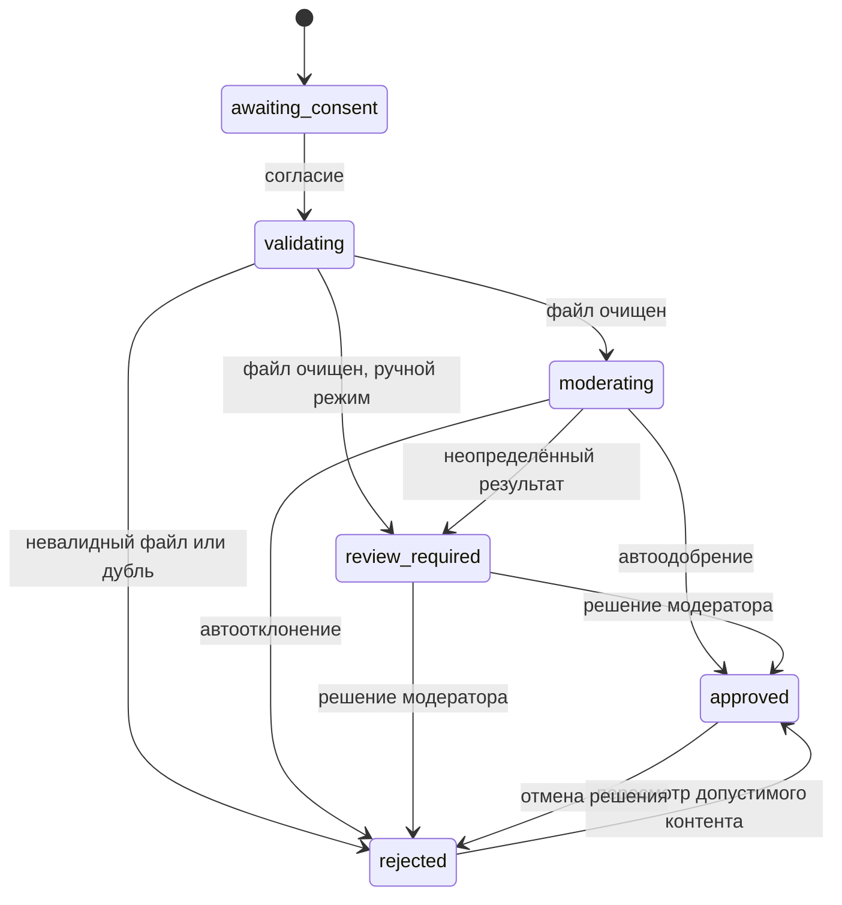
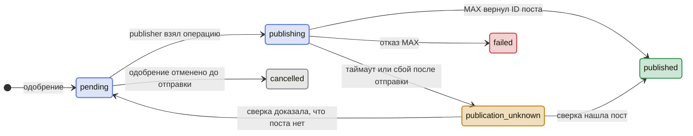
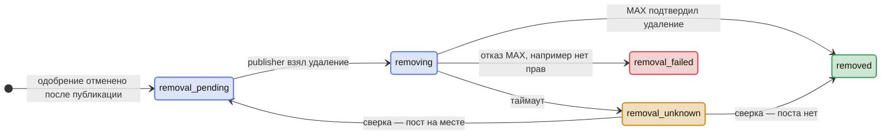

# Данные и состояния

Таблицы PostgreSQL, статусы заявки, жизненный цикл публикации, дубли, рейтинг и розыгрыш. Часть архитектурной документации; обзор и карта документов — в [ARCHITECTURE.md](ARCHITECTURE.md).

## 1. Таблицы

PostgreSQL — источник истины. Минимальные группы таблиц:

| Группа | Сущности |
| --- | --- |
| Пользователь и заявка | `users`, `consents`, `campaigns`, `submissions`, `media_assets` |
| Модерация | `moderation_results`, `moderation_decisions`, `audit_events` |
| Надёжность | `inbox_events`, `processed_events`, `outbox_events` |
| Внешние эффекты | `publications`, `publication_attempts`, `notifications` |
| Рейтинг и розыгрыш | `votes`, `contests`, `contest_entries`, `contest_winners` |

Таблица задаёт целевую модель, миграции вводятся по сценариям. В спринте 1 нужны пользователи, согласия, кампания, заявки, сессии панели, inbox, outbox ответов и аудит; в спринте 2 — объекты, результаты media, решения и публикации; в спринте 3 — результаты CV; рейтинг и розыгрыш — после MVP. Media и CV реализует Dev3, но таблицами и применением результатов владеет Dev2.

## 2. Статусы заявки

### S1-07: согласованные поля и правила первого сценария

Решения Dev2 приняты в [PR #12](https://github.com/MIvi-test/vision-shield-bot/pull/12):
Dev3 одобрил 13 ноября, Dev4 — 14 ноября 2026; PR влит 14 ноября.
Контракт панели с уточнениями влит в [PR #11](https://github.com/MIvi-test/vision-shield-bot/pull/11).

| Сущность | Реализованные поля и ограничения |
| --- | --- |
| `users` | `id UUID`, уникальная связь `(source_id, bot_id, max_user_id)`, уникальный случайный `author_ref`, `created_at` UTC. MAX-ID остаётся внутри Backend; имя не сохраняется |
| `campaigns` | `id UUID`, уникальный `slug`, текущая `rules_version`, `created_at` UTC. Slug: `[a-z0-9][a-z0-9-]{0,63}`; проверяется административной командой |
| `campaign_rules` | Ключ `(campaign_id, version)`, неизменяемый через административную команду текст, дата создания UTC |
| `consent_prompts` | Входное событие, пользователь, кампания и версия предъявляемых правил; подтверждение отправки проверяется по `inbox.state=sent` |
| `consents` | `id UUID`, `user_id`, `campaign_id`, `rules_version`, `accepted_at` UTC, уникальная ссылка на входное событие; уникальность `(user_id, campaign_id, rules_version)` |
| `submissions` | `id UUID`, `user_id`, `campaign_id`, nullable `consent_id`, `status`, `created_at`, `updated_at` UTC, `version >= 1`, уникальная ссылка на входное событие |
| `audit_events` | `id UUID`, `submission_id`, уникальный для заявки `sequence`, `occurred_at` UTC, `from_status`, `to_status`, nullable `reason_code`, `actor`, nullable внутренний `actor_id`, ссылка на входное событие |

UUID создаёт Backend. `author_ref` имеет вид `usr_` + случайный UUID без дефисов;
он стабилен для внутреннего пользователя. `version` заявки начинается с 1,
растёт при переходе состояния; `created_at` не меняется. Первая запись аудита
имеет `from_status=null`, а `sequence` соответствует версии заявки. Панель
получает проекцию истории, где `id` — этот порядковый номер, а не UUID аудита.

Согласие принадлежит пользователю в рамках кампании и версии правил.
Заявка ссылается на конкретное согласие; карточка показывает его
`rules_version` и `accepted_at`. До согласия `consent=null`.
`/start` предъявляет правила, `/agree ВЕРСИЯ` проверяет текущую версию;
сокращённый `/agree` также требует ранее подтверждённой отправки текущих правил
для нового согласия. Повторный `/start` согласие не отменяет.
Фото без согласия создаёт `awaiting_consent`; после согласия все ожидающие
заявки пользователя в кампании становятся `validating`. Фото при действующем
согласии сразу создаёт `validating`. Смена правил требует нового согласия
для новых фото; прежние заявки сохраняют свою ссылку. Скачивания в S1-06 нет.
`bot_started` и кнопки в этот сценарий не входят.

Уникальный ключ события MAX: `(source_id, bot_id, update_type, message_id)`.
Одна заявка и одно согласие ссылаются на уникальное входное событие;
повтор доставки не создаёт повторных эффектов. Inbox, бизнес-изменения,
аудит, текст ответа и marker сохраняются одной транзакцией. Ответ пока
хранится в inbox; отдельный outbox и RabbitMQ — S1-17.

`reason_code` содержит два вида кодов: события `PHOTO_RECEIVED`
(создание заявки) и `CONSENT_ACCEPTED` (переход после согласия), а в будущем
причины решений из [reason-codes.json](../packages/contracts/policies/reason-codes.json),
например `OFF_TOPIC` и `DUPLICATE`. События не нужно добавлять в справочник
причин модерации. Сейчас `actor=user`; целевые значения также `system` и
`moderator`. Действия администратора по модерации отображаются как `moderator`.

В модели и API остаются шесть целевых статусов. S1-06 создаёт только
`awaiting_consent` и `validating`. `validating` ещё не означает, что worker
уже запущен или файл проверен.

Согласованный API панели описан в [openapi.yaml](../packages/contracts/api/openapi.yaml):
сортировка `created_at DESC, id DESC`, курсорная пагинация, `422` для
повреждённого/несовместимого курсора, отдельные аккаунты панели,
административное создание первого аккаунта, сессия 8 часов без продления
через `/auth/me`, стабильный CSRF-токен сессии, защита login через Origin/Referer.
Реализация таблиц аккаунтов/сессий и методов API относится к S1-18;
это не уже существующие возможности S1-06.

### Целевая машина состояний

Заявка содержит автора, кампанию, состояние обработки, действующее решение и `version`. Статус публикации хранится отдельно: отзыв решения не означает, что пост уже удалён.

Повторная CV-проверка создаёт новую операцию. Ручное одобрение не обходит техническую валидацию и обязательные запреты политики; повреждённый файл и дубль требуют новой загрузки. Все решения проверяют текущую `version`; конфликт возвращает `409` и требует обновить данные.

В спринте 1 фото без согласия создаёт `awaiting_consent`; при действующем согласии можно сразу создать `validating`. На этом этапе `validating` означает ожидание файлового пути: скачивание ещё не реализовано и задача media не запускается. В спринте 2 успешная очистка в ручном режиме переводит заявку в `review_required` без CV. В автоматическом режиме спринта 3 используется переход в `moderating` и задача CV. Режим определяется конфигурацией кампании и фиксируется в аудите.

## 3. Жизненный цикл публикации

Жизненный цикл публикации состоит из двух частей: сама публикация и удаление поста, если одобрение отменили после публикации. Цвет состояния: синий — операция в работе, зелёный — успех, жёлтый — исход неизвестен и нужна сверка, красный — подтверждённый отказ, серый — операция отменена.

**Публикация**

**Удаление поста**

Редкие и ручные переходы, которых нет на схемах:

| Откуда | Куда | Когда |
| --- | --- | --- |
| `publishing` | `pending` | Временная ошибка, запрос к MAX точно не ушёл |
| `removing` | `removal_pending` | То же для удаления |
| `publication_unknown` | `cancelled` | Поста нет, а одобрение уже отменено |
| `publication_unknown` | `failed` | Ручное решение не публиковать |
| `failed` | `pending` | Ручной повтор после устранения причины |
| `removal_failed` | `removal_pending` | Ручной повтор после выдачи прав |
| `removed` | `pending` | Явная повторная публикация, если её разрешают правила |

- Из `publication_unknown` и `removal_unknown` автоматического повтора нет: следующий шаг — только после сверки или ручного разбора ([contracts.md](contracts.md) §4).
- Возврат в `pending` или `removal_pending` допустим, только если запрос к MAX гарантированно не отправлен: ошибка загрузки файла, отказ соединения до запроса. Таймаут после отправки — всегда `unknown`.
- Отмена одобрения, пока операция в `publishing` или `publication_unknown`, не прерывает запрос, а ставит флаг `removal_requested`. Если исход окажется `published`, операция сразу переходит в `removal_pending`; если поста нет — в `cancelled`.
- У заявки и канала одна логическая запись публикации; каждая попытка отправки или удаления — строка в `publication_attempts`. Повторная публикация после удаления — новая попытка той же записи, запускаемая явно.
- Статус публикации не заменяет статус заявки: у заявки в `rejected` публикация может ещё находиться в `removal_*`.
- В S1-04 Dev1 уже проверил повторное удаление того же ID: `success=true`, последующее чтение возвращает пустой список ([протокол](results/max-check.md)). Применимость повторного удаления для сверки `removal_unknown` проверяется в S4-02 с учётом прав и неоднозначного ответа; наблюдение не означает гарантии для любого случая.

**Отмена одобрения:** Backend сразу исключает заявку из новых публикаций и рейтинга. Если пост существует — ставит удаление в outbox; завершение отзыва показывает только после подтверждения удаления. Если отправка уже выполняется или её исход неизвестен, фиксирует требование удаления и запускает его после выяснения ID поста. Поздний успех отправки не должен вернуть отменённую заявку в ленту без удаления. Ошибка удаления остаётся видимой модератору.

## 4. Дубли

SHA-256 оригинала считает fetcher при скачивании. Политика по умолчанию: повтор того же файла в той же кампании отклоняется с причиной `DUPLICATE` до декодирования и CV, а случай учитывается в метрике предотвращённых дублей (её требует постановка). Иное правило, например разрешить повтор после отклонения, фиксируем в политике кампании. Поиск похожих изображений через pHash — опционально, позднее.

## 5. Рейтинг и розыгрыш

Backend-часть модуля (таблицы, API, `StatisticsProvider`) делает Dev2, интерфейс организатора — Dev4. Модуль живёт внутри Backend и использует его транзакции, права и аудит.

Рейтинг и розыгрыш реализуются после MVP, но остаются обязательной частью итогового продукта. Основной источник рейтинга согласуем в спринте 1 до реализации модуля. S1-04 уже проверила нативные реакции в доступных ответах: нужные данные не обнаружены, callback-кнопки подтверждены. Это не доказывает отсутствие другого API. Собственные голоса семантически отличаются от реакций MAX и требуют согласования. `MockStatisticsProvider` подходит для разработки и тестов; допустимость его на сдаче нельзя предполагать.

Для собственных голосов вводим уникальность `(campaign_id, submission_id, voter_id)`, проверку публикации, периода голосования и пользователя из подтверждённого callback. Повторная доставка callback не добавляет голос; частота callback ограничивается входным rate limit. Правила отмены голоса, самоголосования и участия нескольких фото одного автора фиксируем в политике. Счётчик в посте обновляем с задержкой, учитывая ограничения редактирования.

Розыгрыш сохраняет неизменяемый снимок участников и рейтинга на закрытие периода, источник данных, версию алгоритма и результат. Для случайного выбора сохраняем seed/параметры для воспроизведения; это само по себе не доказывает честность выбора. Повтор запроса не создаёт новых победителей. Правила ничьих и исключения отозванных заявок определяем заранее; закрытый розыгрыш не пересчитываем молча.

## 6. Реализованный mock-сценарий S1-06

Реализация Dev2 от 13 ноября 2026 принята в PR #12. Уточнения по ревью — 16 ноября.
Таблицы users, campaigns, campaign_rules, consent_prompts, consents, submissions
и audit_events вводит миграция 0002. Кампания включается только явным
BACKEND_CAMPAIGN_ID после административной настройки версии и текста правил.
Согласие связано с пользователем, кампанией и версией; заявка — с конкретным
согласием. Для синтетических источников пользователь уникален по
(source_id, bot_id, max_user_id), author_ref — случайный UUID с префиксом usr_.

Принятие /agree требует подтверждённой доставки текущих правил; версия
в /agree ВЕРСИЯ должна совпадать с текущей. Фото без согласия создаёт
awaiting_consent, при согласии — validating. Согласие переводит все ожидающие
заявки пользователя в кампании в validating, увеличивает version и добавляет
аудит. Inbox, доменные изменения, ответ и marker коммитятся вместе.
Создание/переход фиксируются с номером версии заявки; повтор события
не меняет согласие, заявки или аудит. Один входной event с одним фото или
файлом-кандидатом — одна заявка. Несколько вложений image/file в одном событии
получают просьбу прислать по одному; заявки и согласия не создаются.
Текст прежней версии правил не меняется; новая версия требует нового согласия
для новых фото. У старых заявок остаётся прежняя ссылка на согласие.

Это принятый технический mock-сценарий, не эксплуатация с реальными данными.
Файлы не скачиваются; поле has_photo обозначает один кандидат image/file,
а не доказанный формат изображения. Проверка содержимого и отказ
UNSUPPORTED_FORMAT появятся вместе с media worker в S2-04.
URL/токены вложений не сохраняются. Для S2-02 потребуются media_assets,
привязка кампании к policy_version и режиму manual/auto;
устойчивый приём при проблемном событии расширяется в S4-01.
[Результаты, допущения и границы](results/s1-06-progress.md).
