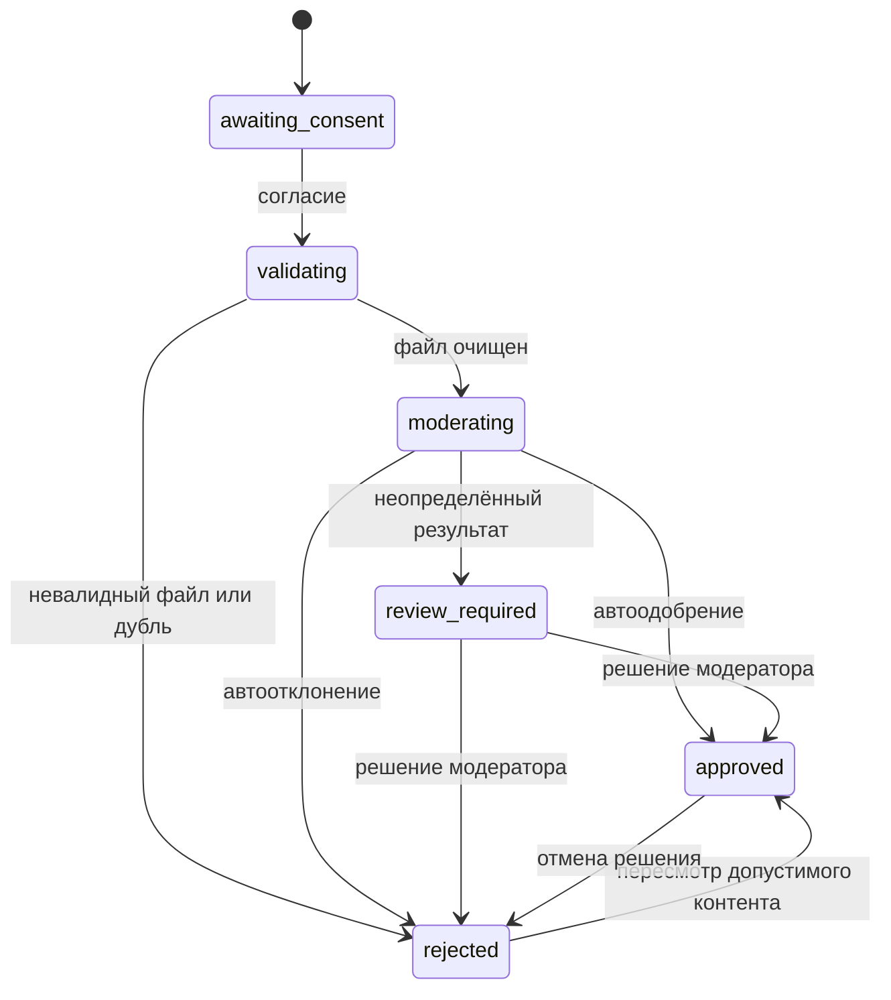
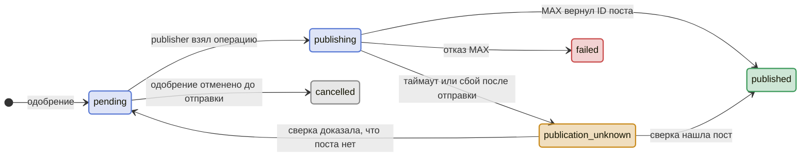
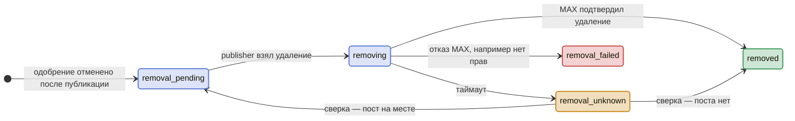

# Данные и состояния

Таблицы PostgreSQL, статусы заявки, жизненный цикл публикации, дубли, рейтинг и розыгрыш. Часть архитектурной документации; обзор и карта документов — в [ARCHITECTURE.md](ARCHITECTURE.md).

## 1. Таблицы

PostgreSQL — источник истины. Минимальные группы таблиц:

| Группа | Сущности |
| --- | --- |
| Пользователь и заявка | `users`, `consents`, `campaigns`, `submissions`, `media_assets` |
| Модерация | `moderation_results`, `moderation_decisions`, `audit_events` |
| Надёжность | `inbox_events`, `processed_events`, `outbox_events` |
| Внешние эффекты | `publications`, `publication_attempts`, `notifications` |
| Рейтинг и розыгрыш | `votes`, `contests`, `contest_entries`, `contest_winners` |

## 2. Статусы заявки

Заявка содержит автора, кампанию, состояние обработки, действующее решение и `version`. Статус публикации хранится отдельно: отзыв решения не означает, что пост уже удалён.

Повторная CV-проверка создаёт новую операцию. Ручное одобрение не обходит техническую валидацию и обязательные запреты политики; повреждённый файл и дубль требуют новой загрузки. Все решения проверяют текущую `version`; конфликт возвращает `409` и требует обновить данные.

## 3. Жизненный цикл публикации

Жизненный цикл публикации состоит из двух частей: сама публикация и удаление поста, если одобрение отменили после публикации. Цвет состояния: синий — операция в работе, зелёный — успех, жёлтый — исход неизвестен и нужна сверка, красный — подтверждённый отказ, серый — операция отменена.

**Публикация**

**Удаление поста**

Редкие и ручные переходы, которых нет на схемах:

| Откуда | Куда | Когда |
| --- | --- | --- |
| `publishing` | `pending` | Временная ошибка, запрос к MAX точно не ушёл |
| `removing` | `removal_pending` | То же для удаления |
| `publication_unknown` | `cancelled` | Поста нет, а одобрение уже отменено |
| `publication_unknown` | `failed` | Ручное решение не публиковать |
| `failed` | `pending` | Ручной повтор после устранения причины |
| `removal_failed` | `removal_pending` | Ручной повтор после выдачи прав |
| `removed` | `pending` | Явная повторная публикация, если её разрешают правила |

- Из `publication_unknown` и `removal_unknown` автоматического повтора нет: следующий шаг — только после сверки или ручного разбора ([contracts.md](contracts.md) §4).
- Возврат в `pending` или `removal_pending` допустим, только если запрос к MAX гарантированно не отправлен: ошибка загрузки файла, отказ соединения до запроса. Таймаут после отправки — всегда `unknown`.
- Отмена одобрения, пока операция в `publishing` или `publication_unknown`, не прерывает запрос, а ставит флаг `removal_requested`. Если исход окажется `published`, операция сразу переходит в `removal_pending`; если поста нет — в `cancelled`.
- У заявки и канала одна логическая запись публикации; каждая попытка отправки или удаления — строка в `publication_attempts`. Повторная публикация после удаления — новая попытка той же записи, запускаемая явно.
- Статус публикации не заменяет статус заявки: у заявки в `rejected` публикация может ещё находиться в `removal_*`.
- Как MAX отвечает на удаление уже удалённого сообщения — проверить: от этого зависит, можно ли сверять `removal_unknown` повтором удаления.

**Отмена одобрения:** Backend сразу исключает заявку из новых публикаций и рейтинга. Если пост существует — ставит удаление в outbox; завершение отзыва показывает только после подтверждения удаления. Если отправка уже выполняется или её исход неизвестен, фиксирует требование удаления и запускает его после выяснения ID поста. Поздний успех отправки не должен вернуть отменённую заявку в ленту без удаления. Ошибка удаления остаётся видимой модератору.

## 4. Дубли

SHA-256 оригинала считает fetcher при скачивании. Политика по умолчанию: повтор того же файла в той же кампании отклоняется с причиной `DUPLICATE` до декодирования и CV, а случай учитывается в метрике предотвращённых дублей (её требует постановка). Иное правило, например разрешить повтор после отклонения, фиксируем в политике кампании. Поиск похожих изображений через pHash — опционально, позднее.

## 5. Рейтинг и розыгрыш

Backend-часть модуля (таблицы, API, `StatisticsProvider`) делает Dev2, интерфейс организатора — Dev4. Модуль живёт внутри Backend и использует его транзакции, права и аудит.

Основной источник рейтинга выбираем до финальной интеграции. Проверяем нативные реакции MAX; если нужных данных нет, согласуем с наставником собственную кнопку голосования. Поддержка кнопок подтверждена документацией, однако собственные голоса семантически отличаются от реакций MAX. `MockStatisticsProvider` подходит для разработки и тестов; допустимость его на сдаче нельзя предполагать.

Для собственных голосов вводим уникальность `(campaign_id, submission_id, voter_id)`, проверку публикации, периода голосования и пользователя из подтверждённого callback. Повторная доставка callback не добавляет голос; частота callback ограничивается входным rate limit. Правила отмены голоса, самоголосования и участия нескольких фото одного автора фиксируем в политике. Счётчик в посте обновляем с задержкой, учитывая ограничения редактирования.

Розыгрыш сохраняет неизменяемый снимок участников и рейтинга на закрытие периода, источник данных, версию алгоритма и результат. Для случайного выбора сохраняем seed/параметры для воспроизведения; это само по себе не доказывает честность выбора. Повтор запроса не создаёт новых победителей. Правила ничьих и исключения отозванных заявок определяем заранее; закрытый розыгрыш не пересчитываем молча.
