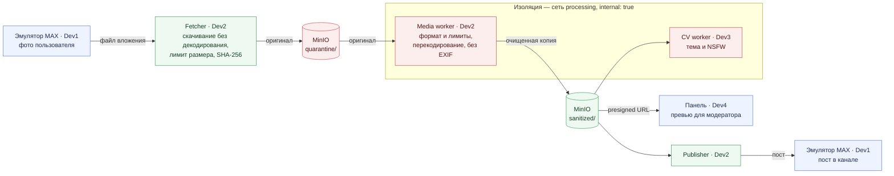
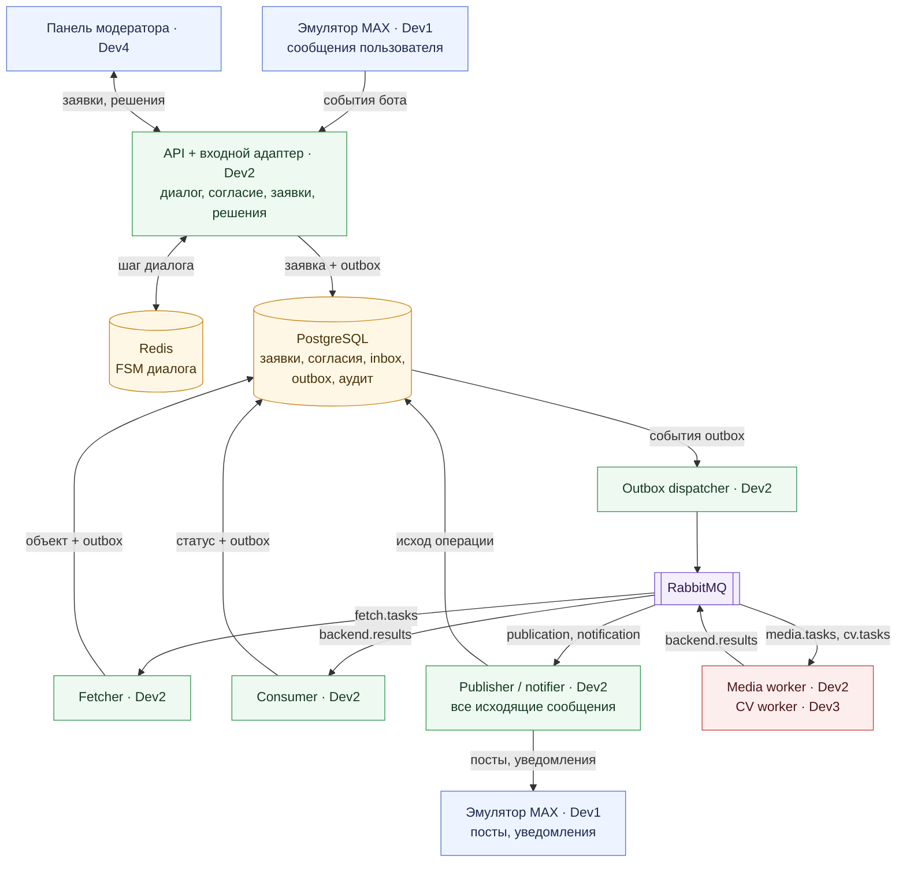
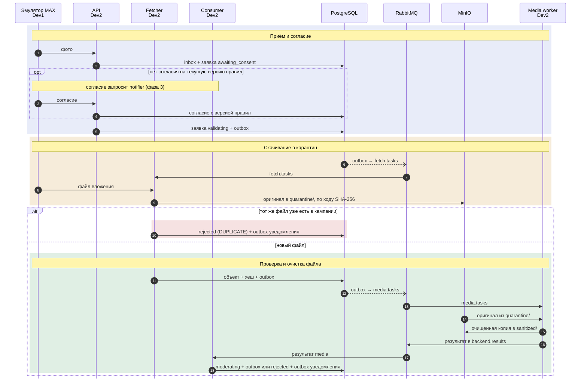
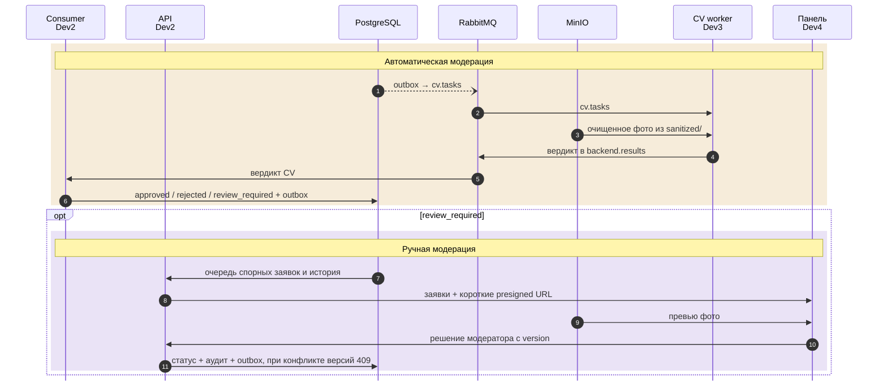
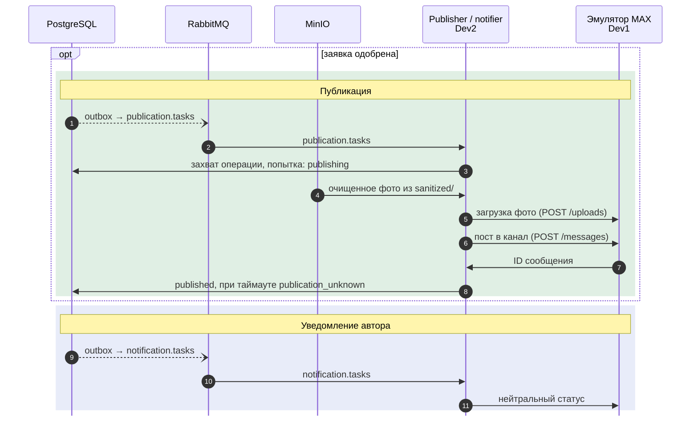

# MVP

MVP — обязательная часть постановки ([assignment.md](assignment.md), раздел «Обязательная часть»), работающая на эмуляторе MAX. Постановка прямо допускает публикацию в эмулятор канала, поэтому реальный MAX в MVP не нужен. Это результат спринта 3 ([sprints.md](sprints.md)).

## Что входит

| Требование постановки | Компоненты | Готово, когда |
| --- | --- | --- |
| Бот принимает изображение и обязательное согласие | Эмулятор, Backend API с входным адаптером, Redis (FSM), PostgreSQL | Без согласия заявка дальше не продвигается; согласие хранится с версией правил |
| Проверка типа, размера и целостности до обработки | Fetcher (размер, SHA-256), media worker (формат, лимиты, перекодирование) | Невалидный файл получает `rejected` с причиной и не доходит до CV |
| Повторная отправка того же файла выявляется | Fetcher | Дубль в той же кампании отклоняется с `DUPLICATE` |
| Тематическая модерация и статус решения | CV worker (сначала заглушка, затем модель + NSFW), Backend consumer | У заявки `approved`, `rejected` или `review_required` с кодами причин |
| Ручная модерация спорных материалов | Панель, Backend API | Модератор решает спорную заявку; конфликт версий даёт `409`; решение есть в истории |
| Публикация в тестовую ленту или эмулятор канала | Publisher, эмулятор | Одобренное фото появляется в канале эмулятора; повтор задачи не создаёт второй пост |
| Уведомление пользователя и журнал событий | Notifier, `audit_events` | Автор получает нейтральный статус; историю заявки можно восстановить по аудиту |

Сквозные гарантии с первого дня: inbox, outbox, `processed_events`, ACK после коммита, карантин и `sanitized/`, запуск `docker compose up` на чистой машине.

## После MVP, до сдачи

Реальный MAX и тестовый канал (цель, но не условие сдачи — ARCHITECTURE.md §1), rate limiting, отзыв опубликованного поста, рейтинг и розыгрыш, Prometheus и Grafana, отказные и нагрузочные тесты, контрактные тесты эмулятора.

## Компоненты

Две схемы: путь файла и путь событий. Стрелка показывает, куда идут данные. Цвета: синий — эмулятор и панель, зелёный — процессы Backend, красный — недоверенный оригинал и изолированные workers, оранжевый — хранилища, фиолетовый — брокер.

### Путь файла и граница доверия

Оригинал лежит только в `quarantine/` и доступен только media. CV, панель и publisher получают только очищенную копию из `sanitized/`.

### События и состояние

Каждый процесс Backend меняет состояние в PostgreSQL вместе с записью в outbox, а dispatcher переносит события в RabbitMQ. Media и CV с PostgreSQL не связаны. Все исходящие сообщения, включая запрос согласия, отправляет notifier.

## Сквозной сценарий

Три фазы. Время идёт сверху вниз, нумерация в каждой фазе своя. Цветная полоса — этап сценария, его название в заголовке полосы: синий — приём и уведомление, жёлтый — скачивание и автоматическая модерация, зелёный — успешная обработка и публикация, красный — отказ, фиолетовый — ручная модерация. Пунктирная стрелка с открытым наконечником — событие из outbox, которое dispatcher переносит в RabbitMQ.

### 1. Приём и проверка файла

### 2. Модерация

### 3. Публикация и уведомление

## Готовность MVP

Фото, отправленное в эмулятор, проходит путь до поста в канале эмулятора и уведомления автору. Спорная заявка решается в панели. Повтор входного события, задачи или результата не создаёт второй заявки и второго поста. Невалидный файл и дубль отклоняются до CV. Стенд поднимается по инструкции на чистой машине.
