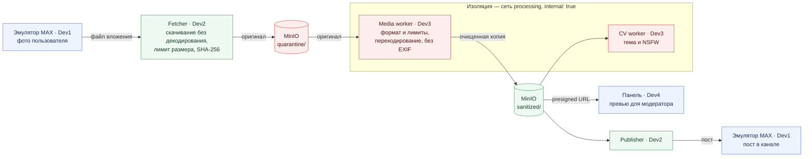
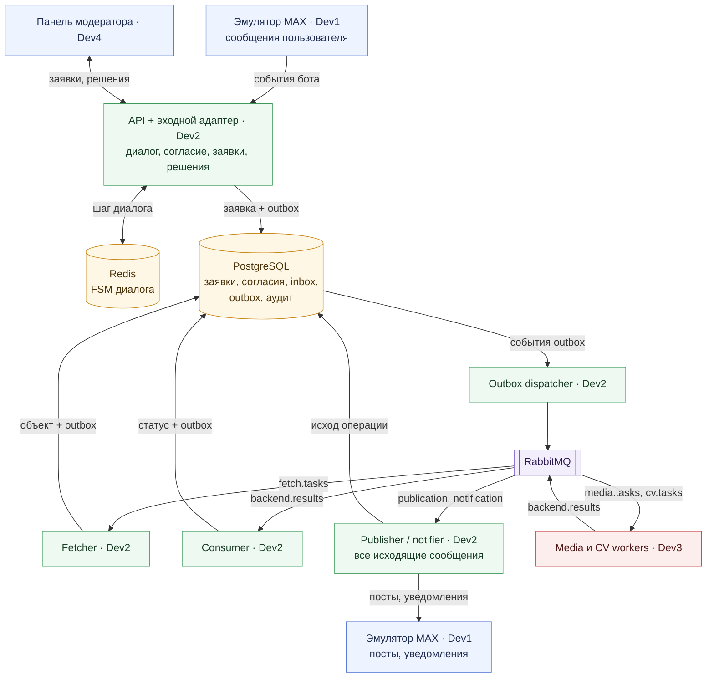
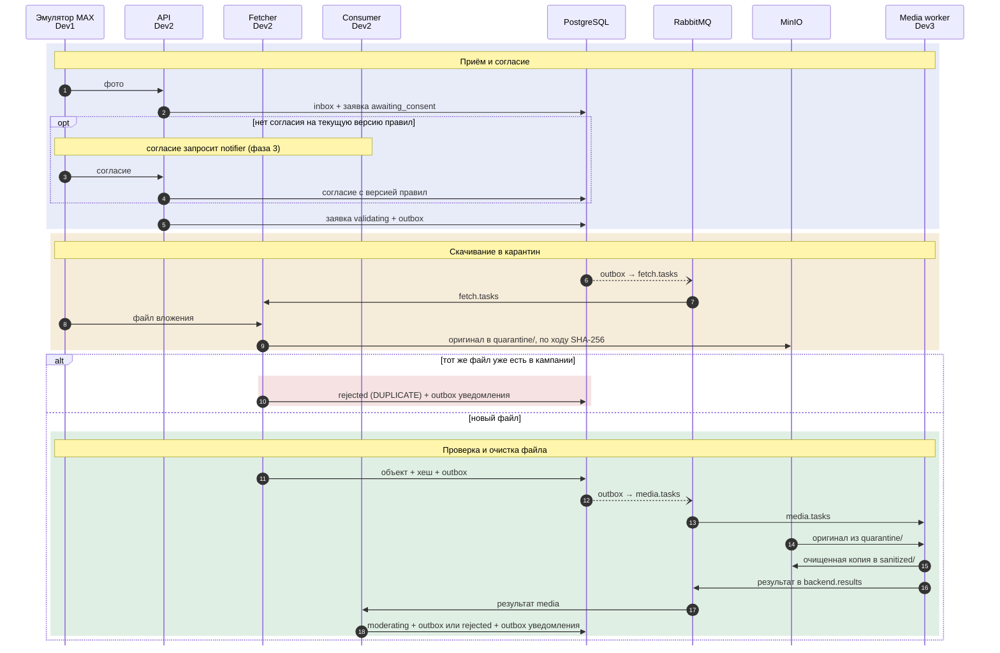
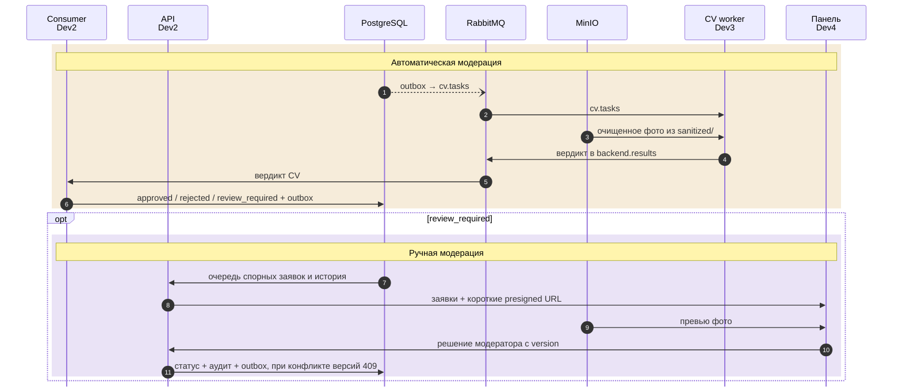
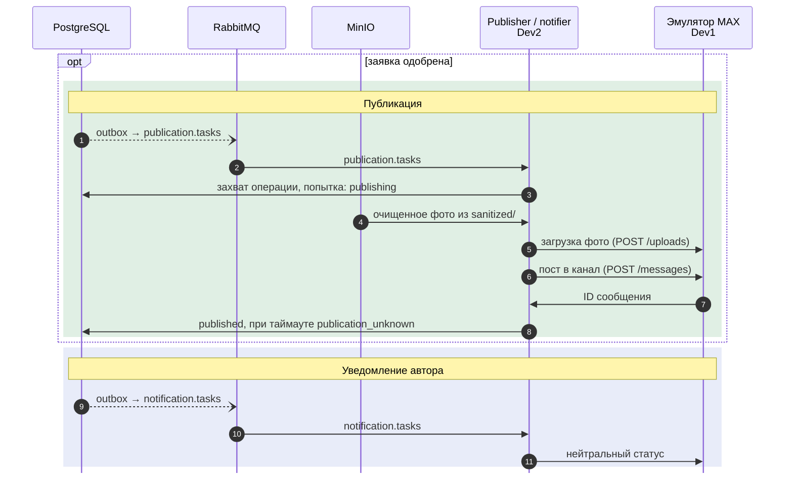

# MVP

MVP — обязательная часть постановки ([assignment.md](assignment.md), раздел «Обязательная часть»), работающая на эмуляторе MAX с настоящими media и CV. Постановка допускает публикацию в эмулятор канала, поэтому реальный MAX в MVP не нужен. Это результат спринта 3 ([sprints.md](sprints.md)); документ задаёт критерии, а не утверждает, что MVP уже реализован.

До MVP есть два запускаемых результата: в спринте 1 — согласие, сохранённая заявка и защищённая панель без скачивания изображения; в спринте 2 — настоящая проверка и очистка, ручное решение, публикация и уведомление. В спринте 3 модель подключается к готовому ручному пути. Исследование моделей и подготовка данных начинаются в спринте 1.

## Что входит

| Требование постановки | Компоненты | Готово, когда |
| --- | --- | --- |
| Бот принимает изображение и обязательное согласие | Эмулятор (Dev1), Backend с входным адаптером (Dev2), PostgreSQL; Redis для временного диалога | Без согласия файл не скачивается; согласие хранится с пользователем, временем и версией правил |
| Проверка типа, размера и целостности до обработки | Fetcher Dev2 (скачивание, размер, SHA-256), media worker Dev3 (формат, лимиты, перекодирование) | Невалидный файл получает `rejected` с причиной, не доходит до CV и не может быть одобрен вручную |
| Повторная отправка того же файла выявляется | Fetcher | Дубль в той же кампании отклоняется с `DUPLICATE` |
| Тематическая модерация и статус решения | CV worker Dev3 с реальными моделями, Backend consumer Dev2 | У заявки `approved`, `rejected` или `review_required` с причинами и версиями; ошибка модели не даёт автоматического одобрения; качество проверено на контрольном наборе |
| Ручная модерация спорных материалов | Панель Dev4, Backend API Dev2; сценарий проверяет Dev3 | Доступ требует входа и роли; модератор решает спорную заявку; конфликт версий даёт `409`; решение есть в истории; превью только очищенное |
| Публикация в тестовую ленту или эмулятор канала | Publisher Dev2, эмулятор Dev1 | Одобренное очищенное фото появляется в канале; повтор завершённой задачи не создаёт второй пост; неоднозначная отправка сохраняет `publication_unknown` и не повторяется вслепую |
| Уведомление пользователя и журнал событий | Notifier, `audit_events` | Автор получает нейтральный статус; историю заявки можно восстановить по аудиту |

Гарантии вводятся вместе со сценарием: inbox, сохранение согласия и outbox ответов — в спринте 1; карантин, `sanitized/`, `processed_events`, подтверждения доставки и учёт публикаций — в спринте 2. К MVP проверены базовые входные/исходящие лимиты и запуск по README на чистом окружении. Media и CV не имеют доступа к PostgreSQL, MAX-токену и интернету. Exactly-once для внешнего MAX API не обещается.

## После MVP, до сдачи

Завершение продукта: пересмотр с отзывом опубликованного поста, рейтинг и розыгрыш по согласованному источнику голосов. Реальный MAX и тестовый канал — цель при наличии доступа, но не условие сдачи (ARCHITECTURE.md §1).

Подготовка к эксплуатации: расширенная сверка неизвестных исходов и разбор DLQ, сроки хранения и отзыв согласия, Prometheus/Grafana, расширенные отказные и нагрузочные проверки, восстановление резервных копий и проверка обновления. Базовые тесты повторов/отказов и контрактные тесты эмулятора уже нужны до MVP. Для ограниченной реальной эксплуатации отдельно подтверждаются ресурсы, нагрузка, HTTPS, режим интеграции и ответственный; учебное демо не объявляется production автоматически.

## Компоненты

Две схемы: путь файла и путь событий. Стрелка показывает, куда идут данные. Цвета: синий — эмулятор и панель, зелёный — процессы Backend, красный — недоверенный оригинал и изолированные workers, оранжевый — хранилища, фиолетовый — брокер.

### Путь файла и граница доверия

Оригинал лежит только в `quarantine/` и доступен только media. CV, панель и publisher получают только очищенную копию из `sanitized/`.

### События и состояние

Каждый процесс Backend меняет состояние в PostgreSQL вместе с записью в outbox, а dispatcher переносит события в RabbitMQ. Media и CV с PostgreSQL не связаны. Все исходящие сообщения, включая запрос согласия, отправляет notifier.

## Сквозной сценарий

Три фазы. Время идёт сверху вниз, нумерация в каждой фазе своя. Цветная полоса — этап сценария, его название в заголовке полосы: синий — приём и уведомление, жёлтый — скачивание и автоматическая модерация, зелёный — успешная обработка и публикация, красный — отказ, фиолетовый — ручная модерация. Пунктирная стрелка с открытым наконечником — событие из outbox, которое dispatcher переносит в RabbitMQ.

### 1. Приём и проверка файла

### 2. Модерация

### 3. Публикация и уведомление

## Готовность MVP

MVP принимается на зафиксированной версии со следующими подтверждениями:

- Фото после согласия проходит настоящие media/CV до автоматического решения, публикации очищенной копии и уведомления; отдельно показаны отказ и ручная ветка.
- Ручной путь требует входа и роли, сохраняет историю и проверяет версию решения; поздний результат CV не отменяет решение человека.
- Невалидный файл и дубль отклоняются до CV; оригинал не доступен панели и publisher.
- Повтор события, задачи или результата не создаёт второй заявки или повторного завершённого эффекта. Падение worker до ACK восстанавливается. Неопределённая отправка явно учитывается и не повторяется без разбора.
- Есть воспроизводимый отчёт по качеству, ошибочным одобрениям/отклонениям, доле ручной проверки, времени и памяти. Критерии качества согласованы до настройки порогов; контрольный набор отделён от настройки. Пока критерии не выполнены, автопубликация выключена, сохраняется результат ручного этапа, а MVP не объявляется готовым.
- Базовые лимиты, файловые ограничения, права и отсутствие секретов в логах проверены; блокирующие дефекты исправлены.
- Человек вне команды запускает стенд по README; CI выполняет реальные тесты и сборку панели, результаты демо и ограничения записаны.
